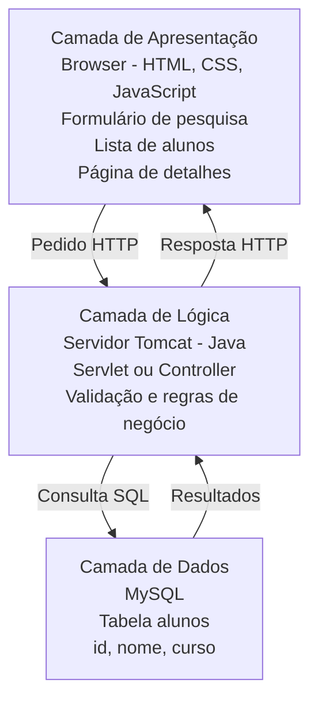

# Hora 2 - Arquitetura Cliente-Servidor

## Atividade 1 - Arquitetura de Três Camadas

### Explicação

- Camada de Apresentação - Mostra o formulário, a lista de alunos e os detalhes no navegador.
- Camada de Lógica - O servidor Java recebe os pedidos, valida os dados e processa a informação.
- Camada de Dados - A base de dados MySQL guarda os dados dos alunos.

## Atividade 2 - Quem Faz o Quê?

| Operação | Responsável |
|---|---|
| Apresentar o formulário de pesquisa | Navegador |
| Validar se o número do aluno é um inteiro positivo | Servidor Java |
| Executar SELECT * FROM alunos WHERE id = 42 | Base de Dados |
| Renderizar a tabela de resultados em HTML | Navegador |
| Gerir índices e otimizar a consulta | Base de Dados |

## Atividade 3 - Seis Passos da Consulta

### Passo 1 - Inserir o ID
- Responsável: Navegador
- O utilizador escreve o número 42 no formulário.
- Resultado: O número fica pronto para ser enviado.

### Passo 2 - Enviar Pedido
- Responsável: Navegador
- O navegador envia um pedido HTTP GET com o ID 42.
- Resultado: O pedido chega ao servidor.

### Passo 3 - Validar Dados
- Responsável: Servidor Java
- O servidor verifica se o ID é um inteiro positivo.
- Resultado: O ID é considerado válido.

### Passo 4 - Consultar a Base de Dados
- Responsável: Servidor Java
- O servidor envia uma consulta SQL à base de dados.
- Resultado: A base de dados recebe a consulta.

### Passo 5 - Executar a Consulta
- Responsável: Base de Dados
- Executa SELECT * FROM alunos WHERE id = 42.
- Resultado: Devolve o registo do aluno ao servidor, se existir.

### Passo 6 - Apresentar Resultado
- Responsável: Servidor Java e Navegador
- O servidor envia a resposta HTTP com os dados.
- O navegador apresenta os dados do aluno numa página.

## Atividade 4 - E se o Servidor Falhar?

### 1. O que vê o utilizador?

O navegador pode apresentar um erro como 502 Bad Gateway ou 503 Service Unavailable. O utilizador não consegue aceder à aplicação.

### 2. Os dados ficam em risco?

Normalmente não. A base de dados continua a guardar a informação, mesmo que o servidor Java esteja indisponível.

### 3. Como minimizar o impacto?

- Reiniciar o servidor quando existir uma falha.
- Utilizar um servidor de reserva para manter a aplicação disponível.
