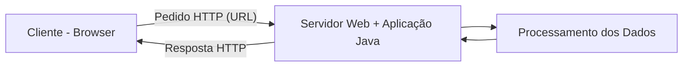

# Desenvolvimento de Aplicações Web em Java

## Ex 1 - Identificar 5 Aplicações Web

| Aplicação | URL | Para que serve |
|---|---|---|
| YouTube | https://youtube.com | Ver vídeos |
| Gmail | https://gmail.com | Enviar e receber emails |
| Google Classroom | https://classroom.google.com | Gerir trabalhos escolares |
| Amazon | https://amazon.es | Comprar produtos online |
| Google Docs | https://docs.google.com | Criar e editar documentos |

## Ex 2 - Classificar por Funcionalidade

- YouTube - Entretenimento
- Gmail - Comunicação
- Google Classroom - Educação
- Amazon - Comércio
- Google Docs - Produtividade

## Ex 3 - Processamento no Servidor

Aplicação escolhida: Amazon

1. Login - O servidor verifica os dados do utilizador para permitir o acesso à conta.

2. Pesquisa de produtos - O servidor procura os produtos na base de dados e apresenta os resultados.

3. Encomendas - O servidor processa a compra, verifica o stock e guarda a encomenda.

## Ex 4 - Esquema Cliente-Servidor

### Funcionamento

1. O cliente envia um pedido HTTP através do navegador.
2. O servidor recebe o pedido e a aplicação Java processa os dados.
3. Se necessário, o servidor consulta a base de dados.
4. O servidor envia uma resposta HTTP ao navegador.
5. O navegador apresenta a página ao utilizador.

**Conteúdo estático:** O servidor devolve os ficheiros diretamente.

**Conteúdo dinâmico:** O servidor processa os dados antes de enviar a resposta.
